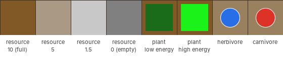

# Toroworld manual

A general description of the simulation: what the world is, what lives in it, the rules, and how to read the map.

> This manual describes the **current state** of the model. It is updated after every significant decision. For *why* things are the way they are, and for the open questions, see [decisions.md](decisions.md). For building, running and changing the parameters, see [how-to-run.md](how-to-run.md).
>
> Last updated: 2026-11-21 (after prompt 14).

## 1. What Toroworld is

A simulation of an ecosystem where plants and animals compete for resources. The world is a grid of cells, time advances in discrete steps (**ticks**), and every organism spends energy to live, eat, move and reproduce. Offspring inherit their parent's genome with small random changes, so species can evolve.

A run is fully **reproducible**: the same configuration and the same random seed always give the same run.

## 2. The world

- **A grid whose edges are joined.** Leaving the right edge brings you back on the left, leaving the bottom brings you back at the top. Topologically this is a torus (a doughnut), which is where the name comes from. There are no borders and no corners: every cell is equal.
- **Default size: 100 x 50 cells.**
- **Neighbours.** Each cell has 8 neighbours: the cells around it, diagonals included. Organisms only see and act on their own cell and these 8.
- **Occupancy.** A cell can hold at most **one plant** and at most **one animal** at the same time. A herbivore can stand on a plant.
- **Resource.** Each cell holds a renewable resource (think of it as nutrients and light). Every cell starts with 5, regains 1 per tick, and never goes above 10. Only plants use it.

## 3. The inhabitants

| Species | Moves? | Eats | Eaten by |
|---|---|---|---|
| **Plant** | no | the resource of its own cell | herbivores |
| **Herbivore** | yes | the plant in its own cell | carnivores |
| **Carnivore** | yes | a herbivore in a neighbouring cell | nobody |

At the start, organisms are placed at random in proportion to the grid size: **50 plants, 20 herbivores and 4 carnivores per 100 cells**. On the default grid that is 2,500 / 1,000 / 200.

## 4. Energy

Energy is the currency of life. Every organism has an energy level.

- **Gaining energy:** only by eating. A plant absorbs resource from its cell; a herbivore takes a bite of the plant it stands on; a carnivore kills a neighbouring herbivore. Only part of the food becomes energy (the efficiency): 80% for plants, 70% for herbivores, 60% for carnivores.
- **Spending energy:** every tick, an organism pays the cost of **one activity** it chose, **plus** a basal cost of living. All costs are multiplied by the organism's metabolism.

| Activity | Plant | Herbivore | Carnivore |
|---|---|---|---|
| Live (every tick) | 0.5 | 0.4 | 0.6 |
| Rest | 0 | 0 | 0 |
| Move one cell | (never moves) | 0.3 | 0.6 |
| Eat | 0.2 | 0.2 | 0.3 |
| Reproduce | 1.0 | 2.0 | 3.0 |

- **Death:** when its energy reaches zero, or when it grows older than its maximum age (60, 80 and 120 ticks for plants, herbivores and carnivores).

## 5. One tick, step by step

1. Every cell regains resource.
2. Every plant acts, in random order.
3. Every animal acts, in random order.
4. Dead organisms are removed.

"Acting" means: choose an activity, carry it out, pay its cost plus the cost of living, then grow one tick older. Costs are paid **after** the action, so a starving organism can still eat and survive. Organisms born during a tick start acting on the next tick.

## 6. How organisms decide

The rules are deliberately simple. In order of priority:

1. **Reproduce**, if energy is above the reproduction threshold and a neighbouring cell is free.
2. **Eat**, if food is within reach.
3. **Move** (animals only). A herbivore steps to the free neighbouring cell with the most energetic plant. A carnivore, or a herbivore with no plant nearby, steps to a random free cell.
4. **Rest**, if nothing else is possible.

**Speed.** An animal moves at most **one cell per tick**, diagonals included, and a tick spent moving is a tick not spent eating. Herbivores and carnivores have the same speed, and speed is not (yet) a genome trait. Because animals only see one cell away, an animal with no food next to it wanders at random.

## 7. Reproduction

- **Asexual, one offspring at a time,** placed in a free neighbouring cell.
- The parent pays the reproduction cost, then gives **40%** of its remaining energy to the offspring.
- Reproduction thresholds: 8 (plants), 25 (herbivores), 30 (carnivores).

## 8. Genome, mutation and the trade-off

Every organism carries its own **genome** of five traits:

| Trait | Meaning | Kind |
|---|---|---|
| metabolism | multiplier on all activity costs | advantage when **lower** |
| intake | maximum food per meal | advantage when **higher** |
| maxAge | maximum age in ticks | advantage when **higher** |
| reproductionThreshold | energy needed to reproduce | strategy |
| offspringShare | share of energy given to the offspring | strategy |

**Mutation (on by default).** At birth, each trait of the offspring has a 10% chance of changing by a small random amount, typically about 5% of its value.

**Trade-off (on by default).** A species cannot improve everything at once. Each genome gets an *advantage* score measured against its species' founder genome (the starting one), counting only the three advantage traits. The score cannot go above zero, so a better intake must be paid for with, for example, a higher metabolism or a shorter life. A mutation that would break this rule is discarded, and the offspring is an exact copy of its parent. The two strategy traits are not part of the budget and drift freely.

## 9. Reading the map

**Cell background: the resource left in the cell.** It goes from light brown (full, 10) to **almost black** (exhausted, 0). The scale is dark: a half-full cell (5) is already dark brown.

> **A black cell is an empty cell whose resource is used up.** It has no plant and no animal, and it has nothing left to feed a new plant yet. It regains 1 per tick and turns brown again within a few ticks, unless a plant keeps draining it.

The colours are:

| What you see | Meaning |
|---|---|
| Light brown | Cell with plenty of resource |
| Dark brown → black | Cell with little or no resource left |
| Green square, dark → bright | Plant. Brighter means more energy, closer to reproducing. |
| Blue circle, white outline | Herbivore |
| Red circle, white outline | Carnivore |

On the default 100 x 50 grid each cell is only 8 pixels wide, so a plant fills almost the whole cell and the brown or black background shows only as a thin border. Black cells are usually cells that a plant drained before it died.

**Buttons**, at the top of the window: **Start/Pause**, **Step** (one tick), **Reset**, the **Speed** slider (ticks per second), and **Manual**, which opens this manual in a separate window.

**Status bar**, at the bottom of the window:
- line 1: current tick and total ticks of the run (e.g. `Tick 15 / 1000`, with "(end)" at the last tick), the number of plants, herbivores and carnivores, and the total resource in the world;
- line 2: grid size, random seed, and whether mutation and the trade-off are on.

## 10. What to expect from the current defaults

The parameters are a first guess, not a calibration. With the defaults:

- **Plants** quickly cover almost the whole grid.
- **Herbivores** crash from 1,000 to about 10–20 within the first 100 ticks. Only a handful are left at tick 1,000, so in some runs they may die out.
- **Carnivores** die out within the first 100 ticks: they first eat most of the herbivores, then starve.

Balancing the carnivores is a known open question (O2 in [decisions.md](decisions.md)), parked for now.
